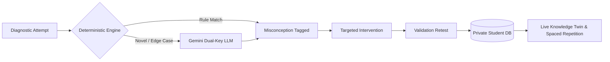

<p align="center">
  
  
  
</p>

# 🧠 Knowledge Twin

> **An AI-powered cognitive architecture that maps, diagnoses, and remediates student misconceptions in real time.**

**Knowledge Twin** moves beyond binary right/wrong grading by maintaining a live, evolving cognitive model of each learner. By pairing symbolic deterministic error classification with dual-key LLM reasoning failover, the platform pinpoints exact micro-skill misconceptions, delivers targeted remediation, and schedules retention practice with decay-aware spaced repetition.

---

## ⚡ How It Works



1. **Diagnose** — Student responses are parsed through an algebraic/symbolic rule engine to detect exact error mechanics (e.g., partial distribution, sign inversion, dropped constants). Unmatched responses seamlessly escalate to Google Gemini with dual-key failover.
2. **Remediate** — The student is routed to tailored interventions (conceptual review, worked examples, guided practice) specific to the tagged misconception.
3. **Validate & Evolve** — An immediate retest verifies gap closure, updating the student's mastery vector, misconception log, and SM-2 spaced repetition decay curves.

---

## 🌟 Key Highlights

- **Hybrid Diagnostic Engine**: Sub-millisecond deterministic pattern matching for 50+ algebraic, physical, and chemical error rules, backed by Google Gemini API fallback.
- **Physical Per-Student Data Isolation**: Strict dual-database architecture separating shared curriculum content (`knowledge_twin.db`) from private, isolated per-student databases (`student_<id>.db`).
- **Interactive Knowledge Twin**: Dynamic skill graph displaying real-time mastery probabilities, active gaps, and forgetting curves.
- **Curated Multi-Domain Content**: Out-of-the-box curriculum covering Linear & Quadratic Equations (Math), Kinematics & Newton's Laws (Physics), and Chemical Bonding (Chemistry).
- **Bring Your Own Material (BYOM)**: PDF ingestion pipeline that automatically decomposes custom course documents into micro-skills and diagnostic items.
- **Educator Intelligence**: Teacher dashboard featuring cohort mastery distributions, at-risk student indicators, and class-wide misconception heatmaps.

---

## 🛠 Tech Stack

| Domain | Technology |
|---|---|
| **Frontend** | React 19, TypeScript, Vite, Lucide Icons, Glassmorphism Design |
| **Backend** | Python 3.10+, FastAPI, Uvicorn, Pydantic v2, SymPy |
| **Persistence** | SQLAlchemy 2.x, SQLite (local multi-DB isolation) / PostgreSQL (Supabase) |
| **AI & Diagnostics** | Deterministic Symbolic Matchers + Google Gemini (Dual-Key Failover) |
| **Document Processing**| PyPDF, Domain Classifiers |

---

## 🚀 Quick Start

### 1. Backend Setup

```bash
cd backend
python -m venv venv

# Windows:
venv\Scripts\activate
# macOS/Linux:
source venv/bin/activate

pip install -r requirements.txt
```

*(Optional)* Create a `.env` in `backend/` or the project root (see `backend/.env.example`):
```env
DATABASE_URL=                          # Leave empty for SQLite per-student isolation
GEMINI_API_KEY_PRIMARY=your_key        # Optional: for LLM fallback diagnostics
GEMINI_API_KEY_SECONDARY=              # Optional: secondary key failover
```

Launch backend server:
```bash
uvicorn app.main:app --reload --port 8000
```
> The shared curriculum automatically seeds on launch. Interactive API docs: `http://127.0.0.1:8000/docs`.

### 2. Frontend Setup

In a new terminal window:
```bash
cd frontend
npm install
npm run dev
```
Open `http://localhost:5173` to launch the Knowledge Twin portal.

---

## 📡 Core API Summary

All endpoints are served under `/api` (interactive documentation at `/docs`):

| Method | Endpoint | Description |
|---|---|---|
| `GET` | `/api/subjects` | List available domains (Math, Physics, Chemistry) |
| `GET` | `/api/chapters/{id}/questions` | Fetch diagnostic question set for a chapter |
| `POST` | `/api/attempts/submit` | Process learner attempt via deterministic rule/LLM engine |
| `GET` | `/api/students/{id}/twin` | Retrieve the student's live cognitive twin graph & mastery state |
| `POST` | `/api/interventions/route` | Serve targeted remediation for an identified misconception |
| `POST` | `/api/interventions/retest` | Validate remediation outcome and update mastery |
| `GET` | `/api/revision/{student_id}` | Fetch decay-weighted spaced repetition tasks |
| `POST` | `/api/documents/upload` | Ingest custom course PDF for skill extraction |
| `GET` | `/api/teacher/overview` | Class analytics, at-risk flags, and struggling topics |

---

## 👥 Team

**Team HACKTRON (T29)** — RVU ARGONYX'26 Hackathon
